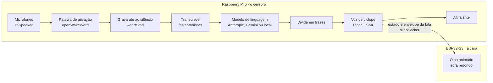

# Ciclope

Assistente de voz feito em casa, com um olho que reage enquanto fala.
Um **Raspberry Pi 5** ouve, pensa e fala; um **ESP32-S3** com ecrã redondo é o olho.



Três ideias sustentam o desenho todo:

- **Fala frase a frase.** A resposta do modelo chega aos pedaços; assim que uma frase fecha, segue para a voz enquanto o modelo continua a escrever. E enquanto uma frase toca, a seguinte já está a ser sintetizada.
- **Meio-duplex.** O microfone fecha enquanto o ciclope fala, por isso ele nunca se ouve a si próprio. O botão do reSpeaker serve para o calar a meio.
- **O olho tem vida própria.** O Pi só diz ao olho em que estado está e manda o envelope de volume de cada frase. Piscar, mexer o olhar e pulsar com a voz são decididos no ESP32.

O código está comentado em português, a explicar os conceitos à medida que aparecem. As decisões de arquitetura e as fontes estão em [`docs/arquitetura.md`](docs/arquitetura.md).

---

## Índice

1. [Estado do projeto](#estado-do-projeto)
2. [Material](#material)
3. [Estrutura do repositório](#estrutura-do-repositório)
4. [Começar no Mac (Fase 0)](#começar-no-mac-fase-0)
5. [O olho no browser](#o-olho-no-browser)
6. [Preparar o Raspberry Pi 5](#preparar-o-raspberry-pi-5)
7. [reSpeaker 2-Mics Pi HAT V2.0 — passo a passo](#respeaker-2-mics-pi-hat-v20--passo-a-passo)
8. [ESP32-S3 com ecrã redondo — passo a passo](#esp32-s3-com-ecrã-redondo--passo-a-passo)
9. [Arrancar sozinho com o Pi](#arrancar-sozinho-com-o-pi)
10. [Configuração](#configuração)
11. [Modelos: API ou local](#modelos-api-ou-local)
12. [Medir](#medir)
13. [Testado e por testar](#testado-e-por-testar)
14. [Licenças](#licenças)

---

## Estado do projeto

| Fase | O que faz | Comando |
|---|---|---|
| 0 | Escreves no teclado, o ciclope responde em voz alta | `ciclope texto` |
| 1 | Falas, ele ouve, transcreve e responde | `ciclope voz` |
| 2 | O olho reage: no browser e no ecrã do ESP32 | `ciclope cara-demo` |
| 3 | Modelo de linguagem a correr no próprio Pi | `fornecedor = "openai"` |

Tudo está escrito e testado em software. Em [Testado e por testar](#testado-e-por-testar) está exatamente o que ainda não correu em hardware real.

## Material

- **Raspberry Pi 5** (4 ou 8 GB) com a fonte oficial de 27 W e um cartão microSD de 32 GB ou mais.
- **reSpeaker 2-Mics Pi HAT V2.0** da Seeed (codec TLV320AIC3104). Tem de ser a V2: a V1 (codec WM8960) não funciona bem no Raspberry Pi OS atual.
- **Ecrã do olho**, uma destas placas Waveshare:
  - **ESP32-S3-Touch-LCD-2.1** — 480×480, cerca de 55 mm. A recomendada.
  - **ESP32-S3-LCD-1.28** — 240×240, cerca de 32 mm. A versão *sem* toque; a "Touch-LCD-1.28" tem outros pinos e não é suportada.
- **Som:** um altifalante passivo pequeno (4–8 Ω) com ficha JST de 2 pinos para a saída de altifalante do reSpeaker, ou colunas com amplificação própria no jack de 3,5 mm do reSpeaker. O Pi 5 não tem jack de áudio.
- Um cabo USB-C **de dados** (não só de carga) para gravar o ESP32.

## Estrutura do repositório

```
ciclope/
├── ciclope/                 o programa do Raspberry Pi (Python)
│   ├── main.py              linha de comandos: texto, voz, dizer, cara-demo...
│   ├── config.py            lê o ciclope.toml e o .env
│   ├── llm.py               modelos de linguagem (Anthropic, Gemini, compatível OpenAI)
│   ├── frases.py            divide o texto em frases à medida que chega
│   ├── tts.py               Piper, efeitos SoX e envelope de volume
│   ├── audio.py             tocar e gravar (sounddevice)
│   ├── ouvidos.py           palavra de ativação, fim da fala, transcrição
│   ├── pipeline.py          a resposta falada, com síntese em paralelo
│   ├── cara.py              servidor WebSocket que alimenta o olho
│   └── hardware.py          botão e LEDs do reSpeaker
├── simulador/index.html     o olho no browser
├── firmware/olho/           o firmware do ESP32-S3 (PlatformIO)
├── scripts/                 instalar o reSpeaker, descarregar a voz, serviço systemd
├── tests/                   testes automáticos (pytest)
├── docs/arquitetura.md      decisões, protocolo e fontes
├── ciclope.example.toml     configuração de exemplo
└── .env.example             onde vão as chaves de API
```

---

## Começar no Mac (Fase 0)

Não precisas de hardware nenhum para isto: o ciclope fala pelos altifalantes do Mac.

**1. Ambiente Python.** Com o [Miniforge](https://github.com/conda-forge/miniforge) instalado:

```bash
conda create -n ciclope python=3.11
conda activate ciclope
```

**2. O projeto.**

```bash
git clone https://github.com/mmcp-s/ciclope.git
cd ciclope
pip install -e ".[voz,dev]"
brew install sox
```

O `-e` instala em modo editável: as mudanças que fizeres no código valem logo, sem reinstalar. O `[voz,dev]` acrescenta os extras dos ouvidos e dos testes.

**3. Configuração e chave.**

```bash
cp ciclope.example.toml ciclope.toml
cp .env.example .env
```

Abre o `.env` e cola a chave do fornecedor que fores usar (`ANTHROPIC_API_KEY` ou `GOOGLE_API_KEY`). No `ciclope.toml`, mete em `[voz] efeitos` os valores de SoX que afinaste para a voz do teu ciclope.

**4. A voz.** Se já tens o `pt_PT-tugão-medium.onnx` (e o `.onnx.json` ao lado), aponta-lhe o caminho em `[voz] modelo`. Senão:

```bash
scripts/descarregar-voz.sh
```

**5. Experimenta.**

```bash
ciclope testar-modelo     # confirma que a chave funciona
ciclope dizer "Quem se atreve a entrar na minha caverna?"
ciclope texto             # a conversa
```

Cada resposta termina com uma linha de medições:

```
[primeira palavra 1.31s · total 6.02s · áudio 5.40s · rácio 1.11 · 3 frases]
```

Para experimentar os ouvidos no Mac, corre `ciclope voz` com `ativacao = "enter"` (é o valor do exemplo): carregas Enter, falas, e ele responde. Na primeira vez o macOS pede autorização para o Terminal usar o microfone, e o Whisper descarrega o modelo.

## O olho no browser

```bash
ciclope cara-demo
```

Abre **http://localhost:8080**. O olho percorre os estados — inativo, a ouvir, a pensar, a falar — sem precisar de modelo nem de voz. Os botões por baixo controlam-no à mão, e podes alternar entre a resolução do ecrã de 1,28" e do de 2,1".

O simulador está sempre disponível enquanto o `ciclope` corre (em `ciclope texto` e `ciclope voz` também), por isso podes ver o olho a reagir a uma conversa real. Num telemóvel na mesma rede, abre `http://<ip-do-computador>:8080`. Se abrires o `simulador/index.html` diretamente do disco, ele procura o Ciclope em `localhost`; para outro endereço, acrescenta `?ws=ws://192.168.1.50:8765` ao fim.

A lógica do olho no simulador é a mesma do firmware. Afinar a expressão aqui é muito mais rápido do que gravar o ESP32 — quando gostares, copia os números para `firmware/olho/src/olho.cpp`.

---

## Preparar o Raspberry Pi 5

**1. Sistema.** No [Raspberry Pi Imager](https://www.raspberrypi.com/software/), escolhe **Raspberry Pi OS Lite (64-bit)** — sem ambiente gráfico, que o Ciclope não precisa. Nas definições de personalização, antes de gravar:

- nome da máquina: `ciclope` (fica acessível como `ciclope.local`);
- o teu utilizador e palavra-passe;
- a rede WiFi;
- SSH ligado.

Liga o Pi e entra a partir do Mac:

```bash
ssh <utilizador>@ciclope.local
```

**2. Pacotes do sistema.**

```bash
sudo apt update && sudo apt full-upgrade -y
sudo apt install -y git build-essential sox libportaudio2
```

O `libportaudio2` é a biblioteca de som que o `sounddevice` usa; o `build-essential` é preciso para compilar o `spidev` dos LEDs.

**3. Miniforge.**

```bash
curl -L -O "https://github.com/conda-forge/miniforge/releases/latest/download/Miniforge3-$(uname)-$(uname -m).sh"
bash Miniforge3-$(uname)-$(uname -m).sh -b
~/miniforge3/bin/conda init bash
exec bash
```

**4. O projeto.**

```bash
conda create -n ciclope python=3.11 -y
conda activate ciclope
git clone https://github.com/mmcp-s/ciclope.git
cd ciclope
pip install -e ".[voz,pi]"
cp ciclope.example.toml ciclope.toml
cp .env.example .env && nano .env
scripts/descarregar-voz.sh
ciclope testar-modelo
```

Segue-se o reSpeaker.

---

## reSpeaker 2-Mics Pi HAT V2.0 — passo a passo

### 1. Confirma que é a V2

O chip do codec diz **TLV320AIC3104** (Texas Instruments). Se disser **WM8960**, é a V1 e estes passos não servem. O nome do produto na Seeed também o indica: *reSpeaker 2-Mics Pi HAT V2.0 … TLV320AIC3104*.

### 2. Montagem

1. Desliga o Pi **e tira-lhe a alimentação**.
2. Se tens o **Active Cooler** oficial do Pi 5, confirma que a placa não toca no dissipador quando encaixada. Nenhuma fonte oficial documenta esta folga. Se tocar, usa um **extensor de pinos de 2×20** (stacking header) ou troca por um dissipador passivo baixo.
3. Alinha os 40 furos do reSpeaker com os 40 pinos do Pi e carrega por igual, até ao fim.
4. Liga o altifalante passivo à ficha JST (saída "SPK") ou as colunas ao jack de 3,5 mm.
5. Se usares altifalante, a Seeed recomenda alimentar também a placa pela micro-USB dela, para haver corrente suficiente.

### 3. Instala o controlador

O codec já vem no kernel do Pi 5; falta só o *overlay* que diz ao Pi que a placa está lá. Um overlay é um bocado de descrição de hardware (*device tree*) que se acrescenta no arranque.

O mais simples:

```bash
scripts/instalar-respeaker.sh
sudo reboot
```

Ou à mão, exatamente como no [wiki da Seeed](https://wiki.seeedstudio.com/respeaker_2_mics_pi_hat_raspberry_v2/):

```bash
sudo apt install -y device-tree-compiler
git clone https://github.com/Seeed-Studio/seeed-linux-dtoverlays.git
cd seeed-linux-dtoverlays/
make overlays/rpi/respeaker-2mic-v2_0-overlay.dtbo
sudo cp overlays/rpi/respeaker-2mic-v2_0-overlay.dtbo /boot/firmware/overlays/respeaker-2mic-v2_0.dtbo
echo "dtoverlay=respeaker-2mic-v2_0" | sudo tee -a /boot/firmware/config.txt
sudo raspi-config nonint do_spi 0     # SPI ligado, para os LEDs
sudo reboot
```

Usa sempre a versão atual do repositório da Seeed: os overlays anteriores a dezembro de 2024 causavam ruído forte no Pi 5.

**Não** instales o `seeed-voicecard` nem sigas tutoriais antigos: é o controlador da V1, e a própria Seeed avisa que pode estragar o ambiente de trabalho no Raspberry Pi OS atual.

### 4. Verifica que o Pi a vê

```bash
arecord -l
```

Deve aparecer uma linha assim (o número do cartão pode ser outro):

```
card 2: seeed2micvoicec [seeed2micvoicec], device 0: 1f000a4000.i2s-tlv320aic3x-hifi ...
```

O `1f000a4000.i2s` é a interface de áudio do Pi 5.

### 5. Testa gravar e ouvir

Troca o `2` pelo número do cartão que o `arecord -l` mostrou:

```bash
arecord -D plughw:2,0 -f S16_LE -r 16000 -c 2 -d 5 teste.wav   # fala durante 5 segundos
aplay -D plughw:2,0 teste.wav
```

A placa grava sempre em estéreo — um canal por microfone. O Ciclope faz a média dos dois.

### 6. Volume

```bash
alsamixer
```

Carrega **F6** e escolhe **seeed2micvoicec**. Pelos nomes do controlador no kernel, os controlos que interessam são **PCM** e **HP** (volume de saída) e **PGA** (ganho dos microfones). A Seeed não documenta valores; ajusta de ouvido. Para o volume sobreviver a reinícios:

```bash
sudo alsactl store
```

### 7. Testa o botão e os LEDs

O botão está no **GPIO17** e os três LEDs (APA102) no **SPI 0**. Com o ambiente `ciclope` ativo:

```bash
# LEDs: devem ficar azuis
python -c "from ciclope.hardware import ReSpeaker; r = ReSpeaker(); r.estado('a_ouvir'); input('Azuis? Enter para apagar '); r.fechar()"

# Botão: carrega algumas vezes nos próximos 15 segundos
python -c "from ciclope.hardware import ReSpeaker; import time; r = ReSpeaker(); r.ao_carregar(lambda: print('carregaste!')); time.sleep(15); r.fechar()"
```

No Pi 5, só o `gpiozero` com o backend `lgpio` funciona — o `RPi.GPIO` dos exemplos antigos da Seeed não suporta o chip do Pi 5. O `pip install -e ".[voz,pi]"` já instalou os dois.

### 8. Configura o Ciclope

No `ciclope.toml`:

```toml
[audio]
saida = "seeed2micvoicec"
entrada = "seeed2micvoicec"

[ouvidos]
ativacao = "palavra"   # ou "botao"

[hardware]
respeaker = true
```

E fala com ele:

```bash
ciclope voz
```

Diz **"Hey Jarvis"** (a palavra pré-treinada por omissão) ou carrega no botão, e faz a pergunta. Enquanto ele fala, o botão cala-o.

### Se algo correr mal

- **O `arecord -l` não mostra a placa.** Confirma que a linha `dtoverlay=respeaker-2mic-v2_0` está no `/boot/firmware/config.txt` e não dentro de uma secção como `[pi4]`. Depois procura mensagens do codec: `dmesg | grep -i -E "tlv320|i2s"`. Com `sudo apt install -y i2c-tools` e `i2cdetect -y 1`, o endereço `18` deve aparecer (como `UU` quando o controlador o está a usar).
- **Ruído forte.** Recompila o overlay a partir da versão atual da Seeed (passo 3).
- **"Invalid sample rate" ao tocar.** O Ciclope reamostra sozinho para a taxa que a placa preferir; se acontecer com o `aplay`, usa `plughw` em vez de `hw`.
- **Botão indisponível.** Confirma que estás no Pi 5 com o `lgpio` instalado (`pip show lgpio`).

---

## ESP32-S3 com ecrã redondo — passo a passo

### 1. Escolhe o ambiente da tua placa

| Placa | Ambiente no PlatformIO |
|---|---|
| Waveshare ESP32-S3-Touch-LCD-2.1 (480×480) | `ws_touch_lcd_21` |
| Waveshare ESP32-S3-LCD-1.28 (240×240, sem toque) | `ws_lcd_128` |

As duas diferem no tipo de memória PSRAM (octal na 2,1", quad na 1,28"). Gravar com o ambiente errado faz a placa reiniciar em ciclo logo no arranque.

### 2. Instala as ferramentas

1. Instala o [VS Code](https://code.visualstudio.com/).
2. Nas extensões, instala **PlatformIO IDE**.

### 3. Abre o projeto do firmware

No VS Code: **File → Open Folder…** e escolhe a pasta **`firmware/olho`** — não a raiz do repositório. É lá que está o `platformio.ini`, e o PlatformIO só reconhece o projeto a partir dele.

A primeira vez que abrires, o PlatformIO descarrega a plataforma ESP32 e as bibliotecas. Demora vários minutos.

### 4. Configura o WiFi e o endereço do Pi

Copia `include/config.example.h` para `include/config.h` e preenche:

```c
#define WIFI_SSID "nome-da-rede"
#define WIFI_PASS "password-da-rede"
#define CICLOPE_HOST "192.168.1.50"   // ou "ciclope.local"
#define CICLOPE_PORTA 8765
```

- O ESP32-S3 só liga a redes de **2,4 GHz**.
- O IP do Pi descobre-se nele com `hostname -I`. Fixa-o no router (reserva de DHCP), para não mudar.
- `"ciclope.local"` também funciona se o Pi se chamar `ciclope`: o firmware pergunta o endereço na rede local por mDNS.
- Para testar com o Mac em vez do Pi, usa o IP do Mac e corre lá `ciclope cara-demo`. O macOS vai perguntar se o Python pode aceitar ligações — aceita.

O `config.h` está no `.gitignore`: a palavra-passe do WiFi nunca vai para o GitHub.

### 5. Escolhe a placa

Na barra azul em baixo, clica no ambiente (`env:…`) e escolhe o da tua placa. Ou muda `default_envs` no `platformio.ini`.

### 6. Liga a placa

- **2,1":** tem duas portas USB-C. Usa a **USB TO UART**. Se preferires a outra (USB nativa), acrescenta as duas linhas comentadas no `platformio.ini`.
- **1,28":** tem uma porta, que passa por um conversor USB-série CH343.

Se o computador não vir nenhuma porta nova, experimenta outro cabo (muitos só carregam) e, se mesmo assim não aparecer, instala o controlador CH343 do fabricante WCH.

### 7. Compila e grava

Clica na seta **→ (Upload)** na barra de baixo, ou no terminal:

```bash
pio run -e ws_touch_lcd_21 -t upload
```

Se a gravação não conseguir ligar à placa, põe-na em modo de gravação à mão: mantém o botão **BOOT** carregado enquanto ligas o cabo USB (ou, se a placa tiver um botão **RESET**, carrega e solta-o com o BOOT carregado), e só depois solta o BOOT. Depois tenta de novo.

### 8. Vê o que ele diz

Abre o monitor série (ícone da ficha, ou `pio device monitor`) a 115200. Deves ver:

```
[olho] a arrancar
[olho] ecrã de 480 px, PSRAM livre: ...
[olho] a ligar ao WiFi "nome-da-rede"...
[olho] WiFi ligado, IP 192.168.1.73
[olho] ligado ao Ciclope
```

### 9. O que deves ver no ecrã

1. Ao arrancar, o olho aparece **cinzento e sonolento**: está vivo, mas ainda sem ligação.
2. Quando liga ao Ciclope, ganha cor e abre-se.
3. Com `ciclope cara-demo` a correr no Pi, percorre os estados. Numa conversa real, olha para cima enquanto pensa, dilata a pupila quando ouve, e a íris acende com a voz.

### Se algo correr mal

- **Reinicia em ciclo logo no arranque.** Ambiente errado para a placa (tipo de PSRAM). Confirma o passo 1.
- **Fica cinzento e sonolento.** Não está a chegar ao Pi. No monitor série vê se ligou ao WiFi e com que IP. Confirma que o `ciclope` está a correr com `[cara] ativa = true` e que o `CICLOPE_HOST` está certo.
- **Ecrã preto na 2,1".** Confirma o ambiente. Se a luz de fundo acende mas não há imagem, o problema está na configuração do ST7701: o código de exemplo da Waveshare mantém o *chip select* em baixo durante toda a configuração (é o que este firmware faz), enquanto o CircuitPython o alterna em cada comando. Não foi testado em hardware qual das duas esta placa exige.
- **Imagem a deslizar ou tremer quando há WiFi (2,1").** O WiFi e o ecrã RGB disputam a PSRAM. A documentação da Espressif recomenda um *bounce buffer*: em `src/ecra.cpp`, troca o último argumento do `Arduino_ESP32RGBPanel` de `0` para `480 * 10`.

---

## Arrancar sozinho com o Pi

Como serviço não há teclado, por isso no `ciclope.toml` do Pi a `ativacao` tem de ser `"palavra"` ou `"botao"` — com `"enter"`, o Ciclope recusa-se a arrancar e diz porquê.

```bash
nano scripts/ciclope.service     # troca UTILIZADOR pelo teu (whoami)
sudo cp scripts/ciclope.service /etc/systemd/system/
sudo systemctl daemon-reload
sudo systemctl enable --now ciclope
journalctl -u ciclope -f          # ver o que ele está a fazer
```

## Configuração

Tudo no `ciclope.toml`, comentado em [`ciclope.example.toml`](ciclope.example.toml). As opções que mais vais mexer:

| Secção | Opção | Para que serve |
|---|---|---|
| `[modelo]` | `fornecedor`, `nome` | quem escreve as respostas |
| `[personagem]` | `sistema` | a personalidade e as regras de fala do ciclope |
| `[voz]` | `efeitos` | a cadeia do SoX que faz a voz de ciclope |
| `[voz]` | `velocidade` | mais lento acima de 1, mais rápido abaixo |
| `[audio]` | `saida`, `entrada` | dispositivos de som (`ciclope dispositivos` lista-os) |
| `[ouvidos]` | `ativacao` | `palavra`, `botao` ou `enter` |
| `[ouvidos]` | `whisper` | `base` (rápido), `small` (equilíbrio), `medium` (lento) |
| `[ouvidos]` | `silencio_fim_ms` | quanto silêncio conta como "acabei de falar" |
| `[hardware]` | `respeaker` | liga o botão e os LEDs |

As chaves de API ficam no `.env`, nunca no `ciclope.toml`.

As opções `-c ficheiro.toml`, `--mudo` (sem som, mas o olho mexe-se) e `--sem-cara` funcionam com qualquer comando. Quando algo falha, o Ciclope mostra o erro numa linha; para ver o erro completo, corre com `CICLOPE_DEBUG=1 ciclope ...`.

## Modelos: API ou local

Os três fornecedores cumprem o mesmo contrato (`ciclope/llm.py`); trocar é uma linha.

| `fornecedor` | Onde corre | Modelo por omissão | Chave no `.env` |
|---|---|---|---|
| `anthropic` | API da Anthropic | `claude-haiku-5-5` | `ANTHROPIC_API_KEY` |
| `gemini` | API da Google (tem nível gratuito) | `gemini-3.5-flash-lite` | `GOOGLE_API_KEY` |
| `openai` | llama-server ou Ollama no Pi; OpenRouter, Groq, Mistral... | o que escolheres em `nome` | `OPENAI_API_KEY` (só nos remotos) |

Os nomes de modelos mudam com frequência: se der erro de modelo inexistente, confirma o nome atual na documentação do fornecedor e põe-no em `nome`.

**Modelo local no Pi.** O que limita um modelo de linguagem num Pi 5 é a velocidade da memória, não a quantidade: cada palavra gerada obriga a ler o modelo inteiro. Na prática, um modelo de 1,5 a 3 mil milhões de parâmetros quantizado a 4 bits (formato GGUF) gera depressa o suficiente para acompanhar a fala, porque o Ciclope fala frase a frase. Com o [llama.cpp](https://github.com/ggml-org/llama.cpp):

```bash
llama-server -m modelo-Q4_K_M.gguf -c 2048
```

E no `ciclope.toml`: `fornecedor = "openai"` e `url_base = "http://127.0.0.1:9931"`. Nas versões recentes do llama-server a porta predefinida passou de 8080 para 9931; no Ollama é `http://127.0.0.1:11434`.

## Medir

Cada resposta imprime:

- **primeira palavra** — segundos até à primeira sílaba audível, contados desde que carregaste Enter (modo texto) ou desde que a gravação terminou (modo voz, com a transcrição do Whisper incluída). Não inclui o silêncio que o Ciclope espera para saber que acabaste de falar (`silencio_fim_ms`). Abaixo de ~1,5 s parece conversa; acima de 3 s parece um formulário.
- **total** e **áudio** — quanto demorou tudo e quanto durou a fala.
- **rácio** — total a dividir por áudio. Perto de 1 significa que o sistema acompanha a fala; muito acima, que há esperas entre frases.

Faz as mesmas cinco perguntas com cada fornecedor e compara: a escolha entre API e modelo local passa a ser feita com números.

## Testado e por testar

**Testado neste repositório:**

- 39 testes automáticos (`pytest`): divisão em frases (incluindo pontos que chegam sozinhos num pedaço), envelope, leitura do streaming dos três fornecedores, resposta falada com interrupção e com falha do altifalante, configuração, e o servidor do olho com clientes reais.
- A cadeia de efeitos com o SoX real, sem saturar.
- O simulador num browser, ligado ao `ciclope cara-demo` por WebSocket, em todos os estados e nas duas resoluções.
- O firmware compila para as duas placas com o Arduino-ESP32 3.3.12 e as mesmas versões de bibliotecas fixadas no `platformio.ini`.
- Uma revisão independente do código, cujos erros foram corrigidos.

**Por testar em hardware real:**

- A síntese com a voz `pt_PT-tugão-medium` pela API Python do Piper (a API foi confirmada no código da biblioteca; a voz em si não pôde ser descarregada no ambiente onde isto foi escrito).
- Microfone, palavra de ativação e Whisper num Pi 5.
- O reSpeaker V2.0, o botão e os LEDs.
- O firmware nas placas Waveshare — ver as notas sobre o ecrã de 2,1" em [Se algo correr mal](#se-algo-correr-mal-1).

## Licenças

O código do Ciclope é Apache-2.0 (ver [`LICENSE`](LICENSE)). As peças de terceiros têm as suas:

- **Piper** (`piper-tts`) é GPL-3.0-or-later. O Ciclope importa-o; a Apache-2.0 é compatível com a GPLv3, mas quem distribuir o conjunto tem de cumprir a GPL.
- A voz **pt_PT-tugão-medium** tem a sua própria ficha (*MODEL_CARD*) no repositório de vozes do Piper.
- Os modelos pré-treinados do **openWakeWord** (como o "hey jarvis") são CC BY-NC-SA 4.0: uso não comercial.
- **faster-whisper** é MIT.

## Próximos passos

- Uma palavra de ativação em português ("Olá, Ciclope"), treinada com o openWakeWord.
- Interromper por voz: o XMOS XVF3800 USB faz cancelamento de eco em hardware e substitui o microfone sem mexer no resto.
- A caixa. Segundo a Seeed: a coluna deve ficar à mesma distância dos dois microfones, e montada sobre borracha para a vibração não chegar a eles pelo plástico.
